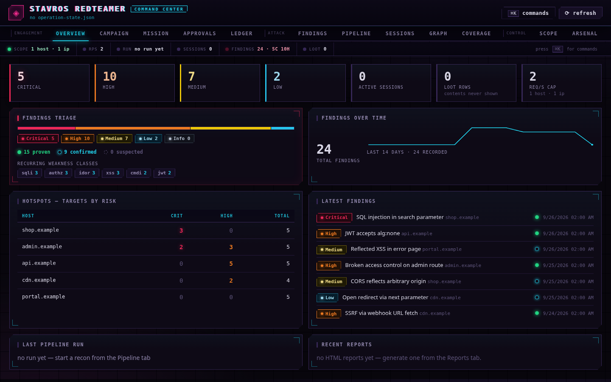

<div align="center">

# Cyboros Harness

**A penetration-testing harness where a finding is only a finding if code can prove it —
and where the lesson of one engagement changes the next.**

[](https://github.com/stavrosredteamer/cyboros-harness/actions/workflows/ci.yml)
[](LICENSE)

[Apache-2.0](LICENSE) · zero dependencies · offline-capable · 122 tests, hermetic and parallel

[Cyboros](docs/OUROBOROS.md): cyber + ouroboros. The loop is not marketing — every claim on
that page names the file that proves it. The agent still cannot violate scope, because the
enforcement is beneath it.


<sub>Three refusals and a green gate — real output of `DEMO_FAST=1 DEMO_PACE=3 ./tools/demo.sh`, not an edit.</sub>



</div>

---

Most AI pentest agents are built to *find* things. This one is built to *refuse to
report things it cannot prove*. That is a different engineering problem, and it is the
one that keeps the whole field honest. The published lab-to-real gap is stark: handed
the advisory text, GPT-4 exploited **87%** of one-day vulnerabilities while *every other
model tested scored 0%* ([Fan et al. 2024](https://arxiv.org/abs/2404.08144)); pointed
at real web targets with no description to lean on, the strongest agent framework
resolved **up to 13%** ([Zhu et al., CVE-Bench, ICML 2025](https://arxiv.org/abs/2503.17332)).
On hard HackTheBox boxes our own runs sit near zero — that last figure is *our* unreleased
observation, not a published result, and we label it that way wherever we repeat it. The
bottleneck is not generation. It is **proof**.

So this harness moves the policy out of the prompt and into the runtime.

> **Evaluating Cyboros for a security team or an organization?** Start with
> [`docs/ADOPTION.md`](docs/ADOPTION.md) — a due-diligence page on authorization,
> client-data governance, auditability and the tool's own security posture, each
> answer naming the file that proves it.

## Two ideas

**1. The agent is not the policy. The runtime is.**

Every other agent in this space handles authorization with a sentence in its README
and then gives the model a shell. Here, the guards are separate programs that run
*below* the model, and they are fail-closed:

- `scope-guard.js` — nothing runs against a host absent from `scope.json`. Empty
  `scope.json` means everything is blocked. There is no flag to disable it.
- A **DNS-rebinding guard**: an in-scope hostname that resolves to a private,
  loopback or link-local address is refused unless that subnet is in `allowed_ips`.
- **Tiered confirmation** for destructive or high-impact actions, and **consent
  tokens** so a confirm-tier action cannot start without an explicit operator grant.
- Rate limits and pacing enforced in-process, not suggested to the model.

The agent can decide to attack. It cannot decide *whether it is allowed to*. The
design principle is simple enough to state in a code review: **a refusal by the
model is a bug, because the guard already made that decision.** Policy belongs in
something the model cannot talk its way past.

**2. Severity can never exceed evidence.**

`record-finding.js` enforces a verification ladder, and rejects incoherent records
rather than warning about them:

| `verify_level` | means | severity ceiling |
|---|---|---|
| `suspected` | plausible, not reproduced | Low |
| `triggered` | condition triggered, not exploited | Medium |
| `exploited` | full exploit chain demonstrated | High |
| `proven_impact` | real impact proven (data read, ATO, RCE) | Critical |

Declare `proven_impact` without a valid oracle and the finding is refused. A finding
that claims reality — `status: verified`, or `exploited`/`proven_impact` — must carry
an **oracle**: a machine-re-executed proof the harness runs itself, N/N times, live.

```json
"verify": {
  "method": "GET", "url": "https://HOST/api/x", "as": "user_a",
  "expect": { "status": 200, "body_contains": "unique-marker" }
}
```

Beyond `status` and `body_contains`, `body_similarity_to` catches the same-length
IDOR that a substring check misses. Every finding also gets an independent
re-verification pass by a separate verifier agent, and `gen-poc.js` writes a
parameterized Python reproducer (`exit 0` = reproduced) so a human can re-run it
without trusting the harness.

Stage gates close the loop: coverage matrix complete, no pending findings, at least
one verified, or **no report is produced at all**.

Findings also leave as **SARIF 2.1.0** (`tools/report-sarif.js`), which GitHub code scanning
and DefectDojo consume unmodified. The evidence ceiling travels with each result in
`properties.cyboros` — `verify_level`, its severity ceiling, the oracle reference — because a
generic consumer cannot infer it. A record whose severity exceeds its verification level is
**refused** and the exporter exits non-zero, so a run that dropped findings cannot pass as a
clean scan.

## Why it might interest you

- **Zero dependencies.** No lockfile, no transitive supply chain, nothing to audit but
  the 53k lines in this repository. CI fails the build if that ever stops being true.
  On a client network, `npm install` does nothing.
- **Runs air-gapped.** `local/` drives the same deterministic engine against a local
  model. No API key, no data leaving the engagement laptop.
- **122 tests, hermetic and parallel by default, no network.** Offline and loopback tests,
  classified by the runner; `npm test` is the gate, `npm run test:all` includes the live e2e
  set. Tests keep the engine's shared state — the global rate limiter, the run audit, the
  findings head-anchor, the egress-proxy state — in a fixture (`hermetic()` in
  `tools/testkit.js`) instead of the workspace, so two runs cannot influence each other;
  measured on a 12-core box at `--jobs 2` (default): 22,7 s vs 42,2 s sequential, `--jobs 4`
  13,6 s, counts identical. On a loaded shared machine the same suite still takes minutes.
- **Evidence memory that compounds.** `memory/` keeps sanitized technique→outcome
  lessons across engagements, with a sanitizer that refuses to store in-scope hosts,
  emails, tokens or credentials.

## Quick start

Requires **Node ≥ 22** (the Command Center backend uses `node:sqlite`).

```bash
git clone https://github.com/stavrosredteamer/cyboros-harness.git
cd cyboros-harness
npm test                 # 122 tests, no install, no network, 2 workers (--jobs 1 to serialize)
```

Then write your authorization. `scope.json` **is** the written authorization, and the
harness is fail-closed until you fill it in:

```json
{
  "allowed_hosts": ["target.example"],
  "allowed_ips": ["10.0.0.0/8"],
  "max_requests_per_second": 2
}
```

```bash
node tools/scope-guard.js check https://target.example   # exit 0 = authorized
node tools/cyboros.js recon target.example
node tools/cyboros.js scan target.example
node tools/cyboros.js status
npm run tui              # terminal surface: scope.json is real, no model call until --live
```

To get `cyboros` as a command — bare `cyboros` opens the TUI, the subcommands keep the
pipeline — run the launcher once and forget the path:

```bash
./scripts/install-cyboros-launcher.sh   # symlink into ~/.local/bin (idempotent, --uninstall to remove)
cyboros                         # TUI
cyboros scan target.example     # same pipeline as node tools/cyboros.js
```

### Live agent with your own provider

The terminal agent can drive a real model. Copy the provider template — the key lives
in the environment, never in the file, and an inline `api_key` is refused:

```bash
cp runtime/providers.example.json runtime/providers.json   # gitignored
export OPENROUTER_API_KEY=...                              # or any OpenAI-compatible key
# or, instead of exporting, keep it in ~/.config/cyboros/openrouter.env (chmod 600)
cyboros target.example        # asks once, at the first message, before any egress
cyboros --allow-cloud target.example   # the flag also connects at launch
```

The key is read from the environment, or from `~/.config/cyboros/<profile>.env` when it is
mode 600; an inline `api_key` in `providers.json` is still refused.

It is one assistant, not two: the same session runs the engagement and answers questions
about it. Ask `what did we find on this host?` and it reads `findings_query`,
`sessions_list` or `session_read` instead of scanning; ask it to verify an object and it
calls `scope_check` then the guarded tools.

The surface is Claude Code's shape: a rounded input box with `>` that redraws as you type,
a slash-command menu above it (filter as you type, `↑`/`↓` to choose, `Enter` to run, `Tab` to
insert), `?` for the shortcut panel, `shift+tab` to cycle ask → plan → auto, your message on a
grey band, `⏺` for the assistant and each tool, one `⎿` with the result tail, `✻` dim for the
reasoning — in a neutral grey/white palette with one warm accent, not neon. Answers
are rendered Markdown — bold, inline code, lists, tables whose cells wrap instead of
overflowing — while they stream. `/thinking off` hides the reasoning, and every turn ends
with duration, tokens and the cost the provider reports.

Every tool call goes through the guarded surface (`scope_check`, `tools/run.js`,
`record-finding.js`), and an intrusive binary stops for an in-session approval. Without
`--allow-cloud`, a cloud profile is refused; `llama` points at a local `127.0.0.1:8080`
for air-gapped runs. `demo/README.md` has an authorized loopback target (IDOR, BOLA,
reflected XSS) and the exact commands to rehearse the whole loop offline from the model's
perspective — the target is local, the model may be cloud.

Install the external tool binaries with `./install-tools.sh` (Parrot/Debian) or
`install-tools.ps1` (Windows), then verify with `node tools/doctor.js`.

### Deploying it for a team

The code and the engagement data are separate directories: one
`cyboros.config.json`, validated at startup (every problem in one message, exit 2,
no silent fallback), and a data directory holding accounts, scope, reports and the
audit trail. First run writes only into that directory:

```bash
node tools/init.js --dir /srv/cyboros --admin alice   # prints the admin password once
CYBOROS_CONFIG=/srv/cyboros/cyboros.config.json node tools/gui-server.js
node tools/config.js --print                          # effective config, token redacted
```

A container definition is in the tree (`Dockerfile`, `docker-compose.yml`) with the
image holding code only and config plus data bind-mounted. See
[`docs/DEPLOY.md`](docs/DEPLOY.md) for the settings table, the environment overrides
and the reverse-proxy notes, and [`docs/UPGRADING.md`](docs/UPGRADING.md) for the
upgrade procedure covering identity data and the append-only audit trail.

The full operator surface — gateway launchers, the desktop Command Center, the local
runner — is documented in [`docs/command-center-desktop.md`](docs/command-center-desktop.md)
and the harness contract in [`docs/ARCHITECTURE.md`](docs/ARCHITECTURE.md).

## The surface

The Command Center is a desktop app over the same engine (`cyboros-cc`, PyQt6, falling
back to Chromium in app-mode). It is a **surface, not a gate**: it bypasses no guard, and
every write it performs is a wrapper over an existing tool.

It has **accounts**: every request is authenticated, and every action is authorized by
role — `viewer` reads, `operator` runs the engagement, `admin` manages accounts. The
audit trail records the signed-in identity as `actor`, never a name a request body
claims. Accounts are one validated `users.json` (mode 0600); the first admin is a CLI
step, and the terminal is not a read-only view. See
[`docs/IDENTITY.md`](docs/IDENTITY.md) — including the one-function seam where an OIDC
backend plugs in without touching a route handler.

Campaign → mission → approval → execution → verification → report → evidence bundle. The
approval inbox is where the consent tokens live: a confirm-tier action cannot start
without a granted, single-use, host-bound grant from the operator. `cc-panic.js` stops
only the processes the harness owns.


*Screenshot: synthetic dataset (RFC 2606 `.example` hosts), captured against an isolated
`CC_ROOT` so no engagement data is involved.*

## What is in here

| | |
|---|---|
| `tools/` | the engine: 183 modules, scope guards, repeater, oracle, pipeline, C2, wifi, GUI, tests |
| `local/fleet/` | 28 agent definitions (orchestrator + specialists) |
| `local/` | standalone runner against a local model — no cloud, no Freebuff |
| `workflows/` | 20 reusable `enum-*` / `attack-*` pipelines |
| `knowledge.md` | the engagement contract: rules, toolbox, verification discipline |
| `docs/` | per-tool and per-class methodology, retrieved with `node tools/kb-search.js` |
| `memory/` | sanitized cross-engagement lessons |

## Scope of use

Authorized testing only: your own systems, a signed engagement scope, in-scope bug
bounty targets, or a lab. `scope.json` names which hosts may be tested; it does not
pre-authorize destructive actions, which still need explicit in-session confirmation.

One honest caveat, stated in [`SECURITY.md`](SECURITY.md) too: the guards run
in-process and are not a sandbox. Tools reached through **MCP** bypass them — unless you
mount the server *through* the proxy:

```bash
node tools/mcp-guard-proxy.js -- npx -y chrome-devtools-mcp@latest --headless --isolated
```

`mcp-guard-proxy.js` puts `scope-guard` and `ssrf-guard` in series with the server: it
judges every `tools/call`, refuses out-of-scope or rebinding targets *before* the request
leaves the machine (the agent gets an explicit error, not a silent failure), and appends
every decision — `allow-scoped`, `allow-unscoped`, `block` — to `reports/tmp/mcp-guard.jsonl`.
Mount a third-party server raw and you are outside the guard and responsible for it
yourself; going through the proxy is the supported path.

## Documentation

- [`docs/ADOPTION.md`](docs/ADOPTION.md) — **for security teams and organizations**: a due-diligence page on authorization, client-data governance, auditability and the tool's own security posture — every answer naming the file that proves it
- [`docs/IDENTITY.md`](docs/IDENTITY.md) — roles, accounts, sessions, the audit actor, and how to plug an OIDC/SSO backend in
- [`docs/DEPLOY.md`](docs/DEPLOY.md) — config surface and precedence, first run, container, reverse proxy, honest limits
- [`docs/UPGRADING.md`](docs/UPGRADING.md) — the upgrade procedure: what each data format guarantees, backups, rollback
- [`docs/OUROBOROS.md`](docs/OUROBOROS.md) — the loop, and the artifact behind every claim
- [`docs/ARCHITECTURE.md`](docs/ARCHITECTURE.md) — guard → model → tool, and why
- [`docs/METHODOLOGY.md`](docs/METHODOLOGY.md) — how this is measured: three metrics, contamination, the severity ceiling (written to apply to any harness)
- [`BENCHMARK.md`](BENCHMARK.md) — the contamination-proof benchmark, and why recall alone is not a claim
- [`docs/TOOL-LANDSCAPE.md`](docs/TOOL-LANDSCAPE.md) — where the published AI-pentest benchmarks stop, argued against the strongest existing work
- [`docs/THREAT-MODEL.md`](docs/THREAT-MODEL.md) — our own attack surface, written down before someone else finds it
- [`docs/GLOSSARY.md`](docs/GLOSSARY.md) — canonical terminology for levels, status and guards
- [`knowledge.md`](knowledge.md) — engagement rules and toolbox (the contract)
- [`docs/project-map.html`](docs/project-map.html) — where everything lives: the 183 modules
  grouped into the 16 areas the harness is thought in (guard, recon, web, host, wireless, mobile,
  opsec, proof, memory, console), the guard chain, the suite gates. Generated by
  `node tools/project-map.js`, so it cannot drift; it also answers the question a flat `tools/`
  does not — where a new module goes
- [`docs/toolbox.md`](docs/toolbox.md) — full flags per tool
- [`docs/TOOL-ALTERNATIVES-AUDIT.md`](docs/TOOL-ALTERNATIVES-AUDIT.md) — cosa è stato valutato e respinto, e perché
- [`docs/methodology-classes.md`](docs/methodology-classes.md) — testing by vulnerability class
- [`docs/host-exploitation.md`](docs/host-exploitation.md) — post-ex, privesc, C2
- [`docs/wireless.md`](docs/wireless.md) — wireless assessment, tier model
- [`docs/RECORDING.md`](docs/RECORDING.md) — how the demo is produced: deterministic, isolated, one command from a GIF
- [`docs/REFS-PROVENANCE.md`](docs/REFS-PROVENANCE.md) — what the reference corpus is, and its licensing status
- [`docs/LAUNCH-PLAN.md`](docs/LAUNCH-PLAN.md) — the campaign: thesis, sequence, channels, what to judge it by
- [`CHANGELOG.md`](CHANGELOG.md) — release history
- [`SECURITY.md`](SECURITY.md) — disclosure policy, safe harbor, in-scope bugs

## Contributing

Issues and pull requests are welcome. Before contributing, please read
[`SECURITY.md`](SECURITY.md) — contributions that weaken the guardrails are treated as
security bugs, not feature requests. Run `npm test` before opening a PR; it is the
same gate CI uses.

## License

Apache-2.0. See [LICENSE](LICENSE).

## Citing this project

If you use the harness, the guard architecture, or `gen-bench.js` in published work,
cite the commit you used rather than `master`:

```
Cyboros Harness — severity-enforced findings and a contamination-proof
precision benchmark for AI security agents.
https://github.com/stavrosredteamer/cyboros-harness @ <commit-sha>
```

Scores produced by this harness are only meaningful alongside the seed, the agent
under test, and the model version. `gen-bench.js eval` writes all three to
`reports/bench-history.jsonl` — publish that line, not just the percentage.
